<p align="center">
  
</p>

<p align="center">
  <a href="https://github.com/netspeedy/blackhole-threats/actions/workflows/build-and-validate.yml"></a>
  <a href="https://github.com/netspeedy/blackhole-threats/actions/workflows/container-image.yml"></a>
  <a href="https://github.com/netspeedy/blackhole-threats/releases"></a>
  <a href="https://netspeedy.github.io/blackhole-threats/"></a>
  <a href="https://ghcr.io/netspeedy/blackhole-threats"></a>
  <a href="go.mod"></a>
  <a href="LICENSE"></a>
  <a href="https://buymeacoffee.com/soakes"></a>
</p>

---

blackhole-threats turns threat feeds into remotely triggered blackhole (RTBH)
routes. It reads local files and HTTP(S) feeds in text, JSON, JSONL or NDJSON,
pulls out the IPv4 and IPv6 prefixes, summarises overlapping networks, and
announces the result to your BGP peers with a blackhole community, so the
routers downstream can drop that traffic.

It runs GoBGP in-process and keeps the routing model easy to audit. Every
refresh builds the route table it wants, withdraws what has gone stale and
announces only what is new or changed. If a feed fails, the routes for that
feed's community stay as they were rather than being flushed. Everything ships
from this repository: release binaries, a GHCR image, Debian packages and a
signed APT repository.

**Quick links:** [Install](#install) · [Try it](#try-it) · [Docs](https://netspeedy.github.io/blackhole-threats/) · [How it works](https://netspeedy.github.io/blackhole-threats/how-it-works/) · [Config keys](https://netspeedy.github.io/blackhole-threats/reference/configuration/) · [Releases](https://github.com/netspeedy/blackhole-threats/releases) · [Discussions](https://github.com/netspeedy/blackhole-threats/discussions)

## Install

### Signed APT repository

On Debian-family hosts the signed APT repository is the recommended production
path. The package installs the binary, a systemd unit, the default environment
file, a man page and the sample config in conventional places: `/usr/sbin/blackhole-threats`, `/etc/blackhole-threats.yaml`,
`/etc/default/blackhole-threats`, `/usr/share/man/man8/blackhole-threats.8.gz`
and `/usr/share/doc/blackhole-threats/examples/blackhole-threats.yaml`.

```bash
sudo install -d -m 0755 /etc/apt/keyrings
curl -fsSL https://netspeedy.github.io/blackhole-threats/blackhole-threats-archive-keyring.gpg \
  | sudo tee /etc/apt/keyrings/blackhole-threats-archive-keyring.gpg >/dev/null

curl -fsSL https://netspeedy.github.io/blackhole-threats/blackhole-threats-archive-keyring.fingerprint.txt

# Verify the fingerprint matches the expected archive key before proceeding.

sudo tee /etc/apt/sources.list.d/blackhole-threats.sources >/dev/null <<'EOF'
Types: deb deb-src
URIs: https://netspeedy.github.io/blackhole-threats/
Suites: stable
Components: main
Signed-By: /etc/apt/keyrings/blackhole-threats-archive-keyring.gpg
EOF

sudo apt update
sudo apt install blackhole-threats
```

The repository carries binary and source indexes, signed metadata, the archive
key and a published fingerprint for checking the key out of band. The package
enables the service and starts it with the example config, so once your own
config is in `/etc/blackhole-threats.yaml`, check it and restart:

```bash
sudo /usr/sbin/blackhole-threats -conf /etc/blackhole-threats.yaml -check-config
sudo systemctl restart blackhole-threats
sudo journalctl -u blackhole-threats -f
```

[Debian package](https://netspeedy.github.io/blackhole-threats/guides/debian/) in the docs walks through the full Debian
path.

### Container image

The image is published to GitHub Container Registry for `linux/amd64` and
`linux/arm64`:

```bash
docker pull ghcr.io/netspeedy/blackhole-threats:latest
docker run -d \
  -p 179:179 \
  -v "$PWD/config:/config" \
  --name blackhole-threats \
  ghcr.io/netspeedy/blackhole-threats:latest
```

`latest` follows stable releases, and release candidates publish to `rc` as well
as their own `v*-rc.*` tag. The image runs on Debian trixie under S6 Overlay,
logs structured lines to stdout, and reads its configuration from `/config`. On
first start it puts the sample config there for you to edit.

### From source

Source builds use your Go toolchain and the Makefile; `go.mod` sets the minimum
Go version.

```bash
git clone https://github.com/netspeedy/blackhole-threats.git
cd blackhole-threats
make build
```

## Try it

Check the packaged configuration without starting BGP:

```bash
blackhole-threats -conf /etc/blackhole-threats.yaml -check-config
```

It checks the local ASN, the router ID, the BGP ports and every feed, then exits without starting BGP:

```text
configuration OK: 11 feed(s)
```

Before binding to production port 179, copy
[`examples/blackhole-threats.yaml`](examples/blackhole-threats.yaml) and replace
the local ASN, router ID, neighbors, feed URLs and communities with your own. Then
run it once with `-once` against a lab peer or an unprivileged local port, and
check the startup log shows the `local_as`, `router_id`, `peer_count` and
`default_community` you expect. Only then enable the long-running service. The
[quickstart](https://netspeedy.github.io/blackhole-threats/quickstart/) runs through this with a local feed, and
[Operations](https://netspeedy.github.io/blackhole-threats/guides/operations/) covers rollouts, manual refreshes,
configuration changes and day-2 work.

## Configuration

The YAML file has two top-level sections: `gobgp`, the GoBGP configuration, and
`feeds`, the threat intelligence sources.

```yaml
gobgp:
  global:
    config:
      as: 64520
      routerid: "198.51.100.10"
      port: 1179
  neighbors:
    - config:
        neighboraddress: "198.51.100.1"
        peeras: 64520
        port: 1179

feeds:
  - url: https://team-cymru.org/Services/Bogons/fullbogons-ipv4.txt
    community: 64520:1101
```

Each feed takes a community written as `<as>:<action>`, with both parts in the
range 0-65535. Leave it out and the feed uses the default `<local ASN>:666`. A
local file path works as a feed URL. BGP ports default to 179 when omitted. The
router ID has to be an IPv4 address even when some neighbors are IPv6. The
example addresses come from documentation ranges, so replace them before you
deploy. [Config keys](https://netspeedy.github.io/blackhole-threats/reference/configuration/) in the docs has the full
schema, and the example file shows a fuller operator setup.

## Runtime controls

```bash
blackhole-threats -conf /path/to/blackhole-threats.yaml -check-config
blackhole-threats -conf /path/to/blackhole-threats.yaml -once
blackhole-threats -conf /path/to/blackhole-threats.yaml -log-format json -log-level info
kill -USR1 <pid>
```

The daemon refreshes every two hours unless you set `-refresh-rate`. `-feed`
adds a feed from the command line and can be repeated. `SIGUSR1`, or
`systemctl reload blackhole-threats` on a packaged install, triggers an
immediate feed refresh and route reconciliation. Neither reloads the YAML or the
flags, so restart the process after a configuration change. Logs are
logfmt-style by default, which suits Docker, journald and syslog;
`-log-format json` switches to newline-delimited JSON.

## Feed behavior

Feeds can be local files with no URI scheme or `http://` and `https://`
endpoints. Text feeds can be plain prefix lists with the usual comment styles;
the first IPv4 or IPv6 prefix on each line is used, and a bare IP address
becomes a host prefix. JSON arrays, JSONL and NDJSON are read for the common fields
`cidr`, `prefix`, `ip` and `address`. Feeds that share a community are grouped,
summarised and published together, and a failure in any of them carries that
community's last good routes forward. [Feeds and communities](https://netspeedy.github.io/blackhole-threats/how-it-works/feeds/)
and [Feed formats](https://netspeedy.github.io/blackhole-threats/reference/feed-formats/) have the parsing, grouping,
summarisation and failure details.

## Documentation

The full documentation is the [blackhole-threats docs site](https://netspeedy.github.io/blackhole-threats/): installation,
how a refresh turns feeds into routes, guides for the Debian package, the
container, router policy and operations, and a reference for every flag, config
key, feed format and log message. The files in [`docs/`](docs/README.md) point
there, apart from [Release and publishing](docs/release-and-publishing.md), which
covers release candidates, stable promotion, the publish workflows and the site
itself for maintainers.

## Releases and CI/CD

Every push to `main` runs Build and Validate, and once it passes the release
workflow cuts the next release candidate from the merged commit history and runs
the prerelease publish path. When that passes and the release only holds
automated updates from Dependabot, Renovate or this repository's workflows, the
same run promotes the candidate to the stable release, which publishes the APT
repository and the `latest` image. A release-bearing change a person merged
waits at the candidate until someone runs the Promote Release Candidate
workflow. Pull requests only
validate: they build, test and package, but never see signing or publish
credentials.

Releases publish Linux tarballs for `amd64`, `arm64` and `arm`, Debian binary
packages for `amd64`, `arm64` and `armhf`, and GHCR images from trusted release
tags. Stable releases add the Debian source package, `deb-src` indexes and signed
APT metadata on GitHub Pages. The GitHub Release carries the operator assets and
checksums, not maintainer byproducts such as dbgsym, buildinfo or changes files.
[Release and publishing](docs/release-and-publishing.md) has the details.

## Contributing and support

Contributions should keep route behavior easy to understand, keep packaging and
releases reproducible, and avoid undocumented surprises in BGP policy or install
paths. If behavior changes, the README, packaging, workflows and docs change with
it. The [contributing guide](CONTRIBUTING.md) covers pull request expectations,
release-note labels, validation scope and public-repo workflow safety.

Operator questions, deployment notes, feed ideas and roadmap discussion are
welcome in [GitHub Discussions](https://github.com/netspeedy/blackhole-threats/discussions).
The project health files are [SECURITY.md](SECURITY.md), [SUPPORT.md](SUPPORT.md),
[CODE_OF_CONDUCT.md](CODE_OF_CONDUCT.md), [GOVERNANCE.md](GOVERNANCE.md),
[ROADMAP.md](ROADMAP.md), [FUNDING.md](FUNDING.md) and
[OPEN_SOURCE_IMPACT.md](OPEN_SOURCE_IMPACT.md).

The original [`ebarkie/blackhole-threats`](https://github.com/ebarkie/blackhole-threats)
by Eric Barkie, published as Blackhole threats (with GoBGP), established the
pattern of advertising threat-feed routes with GoBGP. This repository carries
that model forward with current Go toolchains, packaging, container images and
automated release validation; credit for the original idea is his.

## Development

These checks are the minimum before a code change lands:

```bash
make fmt-check
make vet
make test
make build
```

`make docker-build` builds the container image and `make package` builds the
Debian package. The [docs site](https://netspeedy.github.io/blackhole-threats/) is built with Astro and Starlight from
`website/`, and its [README](website/README.md) covers the `make website-*`
targets and how the site is published. If you add, rename or remove a flag,
update the CLI reference page in the same change: `TestCLIReferenceCoversEveryFlag`
in `cmd/blackhole-threats` fails until the page matches.

The banner at the top of this page and the social cards are generated. Edit the
copy, layout or timing in `scripts/readme/build_readme_hero.py` and run `make
readme-hero`. That rebuilds `assets/blackhole-threats-readme-hero.svg`, the
website's share card, mark and icons, and
`assets/blackhole-threats-social-card.png`, which is the image for GitHub's
social preview and is uploaded by hand in the repository settings. It runs the
script with `uv`, which installs the pinned fontTools it subsets the fonts with, and
renders the cards with headless Chrome or Chromium. The fonts come from
assets.netspeedy.io, so the first run needs network access. If you change the
headline's words, measure them again with `uv run
scripts/readme/measure_headline.py`.

## License

Released under the [MIT License](LICENSE).
